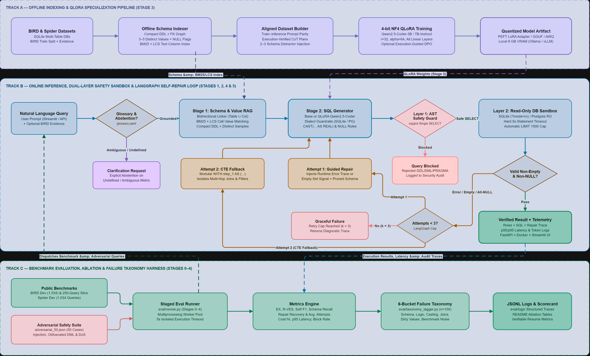
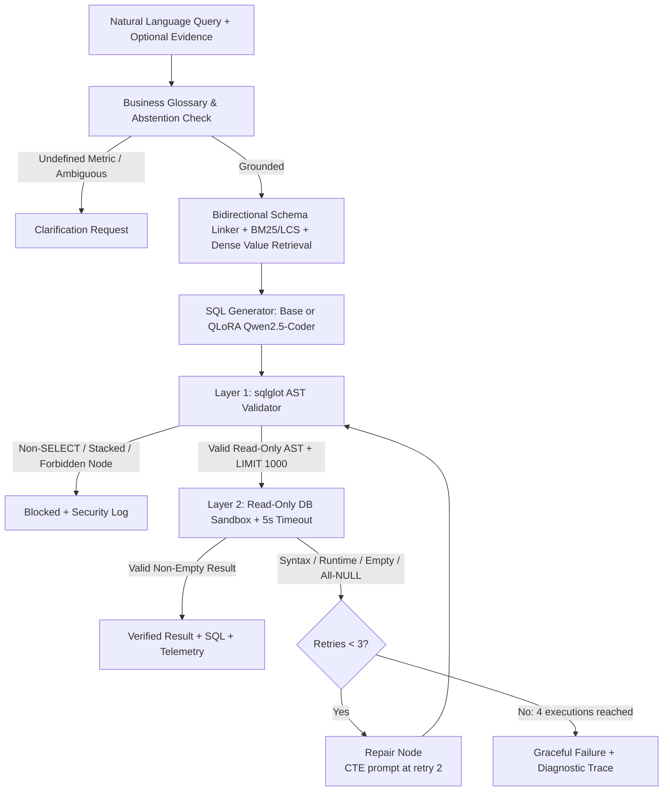

# Assay: Execution-Guided Text-to-SQL Agent with Schema RAG, QLoRA Specialization, and Sandboxed Verification

[](https://www.python.org/downloads/)
[](https://pytorch.org/)
[](https://github.com/langchain-ai/langgraph)
[](https://bird-bench.github.io/)
[](LICENSE)
[](PLAN.md)

## Abstract

**Assay** is a modular Text-to-SQL agent that translates natural language analytical queries into executable, read-only SQL over multi-table relational databases. The pipeline combines **bidirectional schema linking with hybrid cell-value retrieval**, **execution-guided repair via LangGraph**, **a QLoRA specialization pipeline for compact open-weight code models**, **dual-layer static/database safety enforcement**, and **glossary-grounded abstention**.

This repository contains a measured ablation on a fixed **250-query BIRD dev slice** using `qwen2.5-coder:7b` served by local Ollama. Stages 0–2 and the Stage 4 safety/guard artifacts are backed by committed results. The QLoRA training pipeline and dataset builder are implemented, but **no fine-tuned model has been evaluated yet**; full BIRD dev, Spider, and VRAM telemetry are also not included.

---

## Evaluation Coverage & Data Provenance

All headline numbers are derived from `eval/results/*.json`. Where a number has no committed artifact, the table says so instead of filling a placeholder.

| Area | Committed artifact | Status | Notes |
| :--- | :--- | :---: | :--- |
| Stage 0 zero-shot baseline | `eval/results/stage0_baseline.json` | **Measured** | 250-query slice, `qwen2.5-coder:7b` |
| Stage 1 schema RAG | `eval/results/stage1_rag.json` | **Measured** | Same slice and model |
| Stage 1 schema recall | `eval/results/stage1_recall.json` | **Measured** | 98.87% table / 98.55% column recall; dense retrieval has small run-to-run variance |
| Stage 2 self-repair agent | `eval/results/stage2_agent.json` | **Measured** | Same slice and model; fresh agent run |
| Stage 3 QLoRA | `data/train_qlora.jsonl` only | **Not evaluated** | Dataset exists locally; no checkpoint, GGUF, or `stage3_qlora.json` |
| Stage 4 adversarial safety | `eval/results/stage4_safety.json` | **Measured** | Deterministic 50-case guard/abstention audit |
| Stage 4 regression | `eval/results/stage4_regression.json` | **Replay / derived** | Stage 2 predictions re-graded through AST guard + `LIMIT 1000`; latency is a constant placeholder |
| Full BIRD dev (1,534 queries) | — | **Not run** | Only the 250-query slice was evaluated |
| Spider dev | — | **Not run** | No Spider results are committed |
| Peak VRAM | — | **Not measured** | No GPU telemetry was captured |
| PostgreSQL execution | — | **Not implemented** | SQL is transpiled to PostgreSQL; execution remains SQLite-only |
| Docker smoke test | — | **Not evidenced** | Compose files exist, but no smoke-test log is committed |
| Bundled PDF manual | `documentation/Assay_Manual.pdf` | **Historical / theoretical** | Predates this audit; not a results record. README, PLAN, and `eval/results/*.json` are authoritative where they differ. |

### Why the earlier README had gaps

The previous revision mixed planned targets with measured results. In particular:

- Stage 3 was labeled **Verified** even though the verification referred to the dataset/pipeline, not a fine-tuned model evaluation.
- Spider was labeled **Verified** without a Spider run.
- The Stage 4 p95 latency was copied from Stage 2, while the committed Stage 4 artifact records a constant `7.8s` replay placeholder.
- Stage 1 was described as reducing prompt tokens, but the measured prompt-token count rose from `912.0` to `1751.1` (+92.0%).
- Schema recall was quoted as `99.40% / 98.42%`; re-running against the committed indices produced `98.87% / 98.55%` (and `98.47% / 98.45%` on an earlier run), so the non-reproducible figures were removed.
- The safety table attributed 40 blocks to the DB sandbox; the traces show all 40 attacks were stopped by the Layer 1 AST guard, and the remaining 10 prompts were handled by the glossary abstention gate.

---

## Key Results at a Glance

| Metric | Stage 0 baseline | Stage 2 agent | Stage 4 guard replay |
| :--- | :---: | :---: | :---: |
| **BIRD 250-query EX** | `49.20%` | **`51.60%`** (`+2.40 pp`) | `49.60%` (`+0.40 pp` vs Stage 0; `−2.00 pp` vs Stage 2) |
| **R-VES** (local bucketed approximation) | `36.30%` | **`41.40%`** (`+5.10 pp`) | `41.30%` (`+5.00 pp`) |
| **Soft F1** | `54.17%` | **`59.24%`** (`+5.07 pp`) | `57.28%` (`+3.11 pp`) |
| **Avg. prompt tokens** | `912.0` | `2513.4` (`+175.6%`) | `2513.4` (inherited) |
| **p50 / p95 latency** | `0.97s / 1.99s` | `7.80s / 12.82s` | `7.80s / 7.80s` (constant replay placeholder) |
| **Repair recovery** | `0.0%` | **`10.87%`** (`5/46`) | `10.87%` (inherited) |
| **Schema recall (table / column)** | — | `98.87% / 98.55%` | Same retrieval as Stage 2 |
| **Adversarial defense rate** | — | — | **`100.0%`** (`50/50`; 40 AST + 10 abstained) |

**What the table means:**

- The best measured EX is **51.60% at Stage 2**, a `+2.40 pp` gain over the zero-shot baseline.
- Stage 1's richer prompt **did not reduce tokens**; it raised them by 92.0% and moved EX by `−0.40 pp`.
- Stage 4's regression artifact is a **guard replay**, not a fresh model run. `LIMIT 1000` truncated five Stage 2-correct predictions whose result sets contained 3,715–29,936 rows, producing the `−2.00 pp` delta versus Stage 2.
- Stage 3 and Spider are intentionally absent from the table because neither has a committed evaluation result.

---

## System Architecture





> **Retry semantics:** the cap is `retry_count <= 3`, which allows one initial generation plus up to three repairs — **four total executions**. The mandatory CTE-decomposition prompt fires at `retry_count == 2` (the third execution), not on the first repair.

---

## Methodology

### Stage 0 — Zero-Shot Baseline

Sends raw `sqlite_master` DDL plus BIRD `evidence` to `qwen2.5-coder:7b` under zero-shot prompting. Establishes reference EX, R-VES, Soft F1, token usage, and latency on the fixed slice. No frontier-API baseline is committed.

### Stage 1 — Compact Schema Representation & Hybrid Value RAG

Replaces raw DDL with a compact M-Schema and enriches it with matched cell values:

- **Compact DDL + Distinct Value Sampling:** Column names, types, primary/foreign keys, BIRD column descriptions, 3–5 distinct non-null sample values, and explicit `NULL` flags.
- **Bidirectional Schema Linking:** Table-First ∪ Column-First retrieval, followed by foreign-key graph closure.
- **BM25 + LCS Cell Retrieval:** Offline BM25 candidate shortlist plus RapidFuzz normalized LCS/token-sort matching to ground noisy query literals.
- **Dense Retrieval:** `nomic-embed-text` embeddings for table/column candidates, used alongside lexical retrieval.
- **Dialect Guardrails:** SQLite/PostgreSQL prompt rules, including `CAST(... AS REAL)` for integer division.

**Measured trade-off:** EX `49.20% → 48.80%` (`−0.40 pp`), R-VES `36.30% → 30.90%`, Soft F1 `54.17% → 55.52%`, and average prompt tokens `912.0 → 1751.1` (`+92.0%`). The planned token reduction did **not** materialize on this slice.

### Stage 2 — Execution-Guided Self-Repair Loop (LangGraph)

Implements a stateful cyclic graph: `link_schema → generate_sql → execute_and_check → refine_sql → execute_and_check`.

- **Dual Error Triggering:** Routes to repair on runtime/syntax exceptions **and** empty (`len(rows) == 0`) or all-`NULL` result sets.
- **Bounded Retry Budget:** One initial generation plus up to three repairs (four executions total).
- **Error-Tailored Repair:** Feeds the failed SQL, error category, and execution message back to the model.
- **CTE Decomposition Fallback:** At `retry_count == 2`, enforces a `WITH step_1 AS (...)` decomposition prompt to isolate join/aggregation failures.

**Measured outcome:** EX `51.60%` (`+2.80 pp` vs Stage 1; `+2.40 pp` vs Stage 0), R-VES `41.40%`, Soft F1 `59.24%`, repair recovery `10.87%` (`5/46`), average attempts `1.42`. Attempt distribution: `1: 204`, `2: 13`, `3: 6`, `4: 27`. All 27 queries that reached four executions failed; all 27 final queries retained the CTE form.

### Stage 3 — QLoRA Specialization Pipeline

Implements a 4-bit NF4 QLoRA training path for `Qwen2.5-Coder` using PEFT/TRL:

- **Adapter config:** rank `r = 32`, `alpha = 64`, dropout `0.05`, targeting all attention and MLP linear projections.
- **Quantization:** 4-bit NormalFloat (`NF4`) with double quantization and gradient checkpointing.
- **Train–inference alignment:** The dataset builder reuses the Stage 1 compact schema format and injects random distractor tables/columns.
- **Dataset:** 250 examples, 11 databases, average `983.8` estimated tokens (max `1707`, min `530`). `data/train_qlora.jsonl` is generated locally and gitignored.
- **Serving template:** `training/Modelfile` expects a merged `assay-qwen.gguf`.

**Status: not evaluated.** The CoT rationales are derived from gold SQL ASTs, not execution-verified; assistant-only loss masking is not implemented (training covers the full chat text); the `--quantization` CLI flag is accepted but the trainer currently hardcodes NF4; optional Execution-DPO is not implemented. No fine-tuned checkpoint or Stage 3 metrics are committed.

### Stage 4 — Dual-Layer Safety & Business Grounding

- **Layer 1 (Static AST Guard):** Parses each candidate with `sqlglot`, requires a single `SELECT`/`UNION` root, rejects stacked statements and forbidden nodes (`DROP`, `DELETE`, `UPDATE`, `INSERT`, `ALTER`, `ATTACH`, `PRAGMA`, dangerous functions), and injects `LIMIT 1000` when absent.
- **Layer 2 (Database Sandbox):** Read-only SQLite URI (`?mode=ro`), process-isolated 5-second timeout, and bounded result sets.
- **Semantic Glossary & Abstention:** `demo/glossary.yaml` binds business metrics to SQL expressions; unknown metrics and ambiguous terms return clarification requests instead of speculative SQL.
- **PostgreSQL path:** SQL is transpiled with `sqlglot.transpile(read="sqlite", write="postgres")`, but the API still executes against SQLite. The demo PostgreSQL container is seeded and unused.

**Safety audit:** 50/50 cases defended. All 40 destructive/stacked/metadata attacks were blocked by the **Layer 1 AST guard**; all 10 metric/ambiguity prompts were **abstained** by the glossary gate. No attack reached the database sandbox. The audit is deterministic and completed in `0.02s`; it is not an end-to-end latency benchmark.

**Regression caveat:** The committed Stage 4 regression re-grades Stage 2 predictions after guard sanitization. Of 250 predictions, 210 received an injected `LIMIT 1000`; the other 40 already contained a `LIMIT`. The `LIMIT` truncated five previously correct result sets with more than 1,000 rows, reducing EX from `51.60%` to `49.60%`. The current `run_stage_4` code performs a fresh agent run, so re-running it will not reproduce the committed replay artifact exactly.

---

## Experimental Setup & Detailed Results

### Datasets & Evaluation Protocol

- **BIRD dev slice (250 queries):** Fixed stratified sample (`random.seed(42)`) from BIRD dev: 150 simple, 76 moderate, 24 challenging, spanning 11 databases. This is the only benchmark slice with committed stage results.
- **Full BIRD dev (1,534 queries):** Supported by `eval.runner --full`, but **not run** for this snapshot.
- **Spider dev:** **Not run.** No Spider database or result artifact is committed.
- **Adversarial suite (50 cases):** 15 direct DML/DDL, 15 stacked/injection, 10 metadata/`PRAGMA`/`ATTACH`, 7 unknown-metric abstention, 3 ambiguity abstention (`data/adversarial_50.json`).

### Metric Definitions

- **Execution Accuracy (EX):** Multiset tuple equality between predicted and gold results, with exact order enforced only when gold SQL contains `ORDER BY`; executed under a 5-second process-isolated timeout.
- **R-VES:** Local bucketed approximation of BIRD's reward-based efficiency score (`1.25 / 1.00 / 0.75 / 0.50 / 0.25 / 0.00`) based on the gold/prediction runtime ratio. It is not the official BIRD evaluation script.
- **Soft F1:** Cell-level precision/recall F1 over normalized result cells.
- **Schema Linking Recall:** Fraction of gold-SQL tables and columns retained by the Stage 1 linker.
- **Repair Recovery Rate:** Percentage of queries needing more than one execution that become execution-correct within the retry budget.

### 1. Staged Ablation Study (250-Query BIRD Dev Slice)

| Stage | Configuration | EX (%) | Δ vs previous evaluated stage (pp) | Δ vs Stage 0 (pp) | R-VES (%) | Soft F1 (%) | Avg. prompt tokens | Avg. attempts |
| :---: | :--- | :---: | :---: | :---: | :---: | :---: | :---: | :---: |
| **0** | Zero-shot raw DDL | `49.20` | `—` | `—` | `36.30` | `54.17` | `912.0` | `1.00` |
| **1** | + compact schema RAG & BM25/LCS values | `48.80` | `−0.40` | `−0.40` | `30.90` | `55.52` | `1751.1` | `1.00` |
| **2** | + LangGraph repair (3 repairs / 4 executions) | **`51.60`** | `+2.80` | `+2.40` | `41.40` | `59.24` | `2513.4` | `1.42` |
| **3** | + 4-bit QLoRA specialization | *Not evaluated* | `—` | `—` | `—` | `—` | `983.8` (dataset estimate) | `—` |
| **4** | + AST guard & abstention (guard replay) | `49.60` | `−2.00` (vs Stage 2) | `+0.40` | `41.30` | `57.28` | `2513.4` (inherited) | `1.42` (inherited) |

Stage 3 has no evaluation artifact, so it cannot serve as the "previous evaluated stage" for Stage 4. Stage 4 token, attempt, and repair values are inherited from the Stage 2 replay.

### 2. BIRD Difficulty-Band Breakdown

| Stage | Simple (n = 150) | Moderate (n = 76) | Challenging (n = 24) | Overall EX (%) | Simple → Challenging drop (pp) |
| :--- | :---: | :---: | :---: | :---: | :---: |
| Stage 0 | `56.00` (84) | `39.47` (30) | `37.50` (9) | `49.20` | `18.50` |
| Stage 1 | `56.00` (84) | `38.16` (29) | `37.50` (9) | `48.80` | `18.50` |
| Stage 2 | `57.33` (86) | `44.74` (34) | `37.50` (9) | **`51.60`** | `19.83` |
| Stage 4 (replay) | `56.00` (84) | `40.79` (31) | `37.50` (9) | `49.60` | `18.50` |

Counts in parentheses are correct queries out of the band total. The challenging band remained at `37.50%` across all stages.

### 3. Systems, Latency & Cost Telemetry

| Configuration | Avg. prompt tokens | Δ vs Stage 0 | p50 latency | p95 latency | Wall time | Peak VRAM | Local API cost |
| :--- | :---: | :---: | :---: | :---: | :---: | :---: | :---: |
| Stage 0 (raw DDL) | `912.0` | baseline | `0.97s` | `1.99s` | `276.9s` | Not measured | `$0.00` |
| Stage 1 (+ schema RAG) | `1751.1` | `+92.0%` | `7.38s` | `9.09s` | `1901.9s` | Not measured | `$0.00` |
| Stage 2 (+ LangGraph agent) | `2513.4` | `+175.6%` | `7.80s` | `12.82s` | `2132.6s` | Not measured | `$0.00` |
| Stage 4 (+ AST guard) | `2513.4` (inherited) | `+175.6%` | `7.80s` (placeholder) | `7.80s` (placeholder) | `17.0s` (replay) | Not measured | `$0.00` |

- **Token overhead:** Stage 1 increased prompt tokens by `92.0%`; Stage 2 added repair context for a total `+175.6%` over baseline.
- **Latency:** Stage 4's constant `7.80s` values are replay placeholders, not measurements. Stage 0–2 p50/p95 values come from the committed result JSONs.
- **Cost:** `$0.00` reflects local Ollama inference only; hardware, electricity, and engineering time are excluded.
- **VRAM:** No GPU memory telemetry was captured, so no VRAM figure is claimed.

### 4. Adversarial Safety Audit (`data/adversarial_50.json`)

| Category | Cases | Defended | Layer 1 AST blocks | Glossary abstentions | Defended rate |
| :--- | :---: | :---: | :---: | :---: | :---: |
| Direct DML/DDL | 15 | `15` | `15` | `0` | `100.0%` |
| Stacked queries / prompt injection | 15 | `15` | `15` | `0` | `100.0%` |
| Metadata / `PRAGMA` / `ATTACH` probes | 10 | `10` | `10` | `0` | `100.0%` |
| Unknown-metric abstention | 7 | `7` | `0` | `7` | `100.0%` |
| Ambiguity abstention | 3 | `3` | `0` | `3` | `100.0%` |
| **Overall** | **50** | **`50`** | **`40`** | **`10`** | **`100.0%`** |

No case reached Layer 2, so the suite validates the AST guard and glossary gate, not sandbox timeout behavior under adversarial load. The 40 AST outcomes include `NON_SELECT_ROOT`, `STACKED_QUERIES`, `FORBIDDEN_NODE_DELETE`, `DANGEROUS_FUNCTION`, and one `PARSE_ERROR`.

---

## Failure Taxonomy & Error Analysis

The results use the buckets defined in `eval/taxonomy.classify_error`; five had non-zero counts, while `timeout` had none. Counts below are computed from the full failure sets in the committed result JSONs, not from a 100-case sample.

| Failure bucket | Stage 2 failures (n = 121) | Share | Stage 4 failures (n = 126) | Share |
| :--- | :---: | :---: | :---: | :---: |
| `schema_missing` — missing tables/columns, bridge-table omissions | `15` | `12.4%` | `15` | `11.9%` |
| `logic_mismatch` — semantic/join/aggregation mismatches | `94` | `77.7%` | `100` | `79.4%` |
| `empty_result` — empty prediction where gold returned rows | `9` | `7.4%` | `9` | `7.1%` |
| `syntax_error` — SQLite syntax/parse failures | `2` | `1.7%` | `1` | `0.8%` |
| `type_or_div_error` — type mismatch or integer-division truncation | `1` | `0.8%` | `1` | `0.8%` |
| `timeout` — 5-second execution timeout | `0` | `0.0%` | `0` | `0.0%` |
| **Total** | **`121`** | **`100.0%`** | **`126`** | **`100.0%`** |

**Interpretation notes:**

- `join_error` appears in the taxonomy tagger's display labels but is **not emitted** by `classify_error`; join-path failures are reported under `logic_mismatch`.
- “Benchmark annotation noise” is **not** an automatic classifier bucket. Suspected annotation issues require manual review and are not counted separately.
- The six additional Stage 4 logic failures and one fewer syntax failure are consistent with the five `LIMIT 1000` regressions plus one syntax-to-logic reclassification. Stage 4 introduced no improvements over Stage 2 in this replay.

---

## Repository Structure

```text
Assay/
├── AGENTS.md                        # Agent behavioral & coding rules
├── PLAN.md                          # Execution plan, gates, and ablation ledger
├── README.md                        # This document
├── LICENSE                          # MIT license
├── .env.example                     # Config template (tracked)
├── .env                             # Local config (gitignored)
├── requirements.txt
├── Dockerfile
├── docker-compose.yml
├── data/
│   ├── bird_dev_slice_250.json      # Fixed stratified 250-query BIRD dev slice
│   ├── adversarial_50.json          # 50-case safety/abstention suite
│   ├── train_qlora.jsonl            # Generated QLoRA dataset (gitignored)
│   └── benchmarks/                  # Local BIRD/Spider databases & indices (gitignored)
├── documentation/
│   ├── Assay_Manual.pdf
│   ├── Assay_Workflow.drawio
│   └── Assay_Workflow.png
├── eval/
│   ├── make_slice.py                # Deterministic stratified slice generator
│   ├── metrics.py                   # 5s timeout-isolated EX, R-VES, Soft F1 + sanity check
│   ├── runner.py                    # Staged ablation runner (--stage 0..4)
│   ├── taxonomy.py                  # Core failure classifier
│   ├── taxonomy_tagger.py           # CLI failure-taxonomy report
│   ├── eval_recall.py               # Table/column schema-recall evaluator
│   ├── analyze_failures.py          # Stage 0 failure deep-dive
│   ├── logs/                        # Raw per-query JSONL traces (gitignored)
│   └── results/
│       ├── stage0_baseline.json
│       ├── stage1_rag.json
│       ├── stage1_recall.json
│       ├── stage2_agent.json
│       ├── stage4_regression.json
│       ├── stage4_safety.json
│       └── summary_metrics.json
├── src/
│   ├── llm.py                       # OpenAI-compatible Ollama client wrapper
│   ├── schema/
│   │   ├── indexer.py               # Compact M-Schema, BM25, value sampler, embeddings
│   │   └── linker.py                # Bidirectional linking, BM25+LCS, dense retrieval, FK closure
│   ├── agent/
│   │   ├── state.py                 # TypedDict state schema
│   │   ├── graph.py                 # LangGraph retry loop (4 executions, CTE fallback)
│   │   └── prompts.py               # Dialect-aware generation/repair/CTE prompts
│   ├── safety/
│   │   └── guard.py                 # sqlglot AST validator + read-only timeout sandbox
│   └── api/
│       ├── main.py                  # FastAPI service + telemetry
│       └── abstention.py            # Glossary semantic gate
├── training/
│   ├── build_dataset.py             # Train-inference aligned dataset + distractor injection
│   ├── train_qlora.py               # 4-bit NF4 QLoRA trainer (PEFT/TRL)
│   └── Modelfile                    # Ollama serving template for merged GGUF
└── demo/
    ├── glossary.yaml                # Business metric definitions
    ├── seed.sql                     # PostgreSQL demo seed
    ├── app.py                       # Streamlit UI
    ├── Dockerfile
    └── docker-compose.yml
```

---

## Reproducibility & Quickstart

### 1. Environment Setup

```bash
git clone https://github.com/IcodeHZShreyashGZ/Assay.git
cd Assay
python -m venv .venv && source .venv/bin/activate
pip install -r requirements.txt
cp .env.example .env
```

Start Ollama and pull the two models used by the committed results:

```bash
ollama serve
ollama pull qwen2.5-coder:7b
ollama pull nomic-embed-text
```

The default `.env` points at `http://localhost:11434/v1` with generation model `qwen2.5-coder:7b` and embedding model `nomic-embed-text`.

### 2. Prepare BIRD Data

Download the BIRD dev release into `data/benchmarks/bird/`:

```text
data/benchmarks/bird/
├── dev.json
├── dev_tables.json
└── dev_databases/
```

Rebuild the deterministic slice if needed:

```bash
python -m eval.make_slice \
  --bird-dev data/benchmarks/bird/dev.json \
  --output data/bird_dev_slice_250.json
```

### 3. Sanity-Check the Harness

```bash
python -m eval.metrics --sanity-check data/bird_dev_slice_250.json
```

The gold sanity check should report 100% accuracy with zero timeouts before any stage is run.

### 4. Build Schema Indices

```bash
python -m src.schema.indexer \
  --benchmark bird \
  --split dev \
  --db-dir data/benchmarks/bird/dev_databases
```

Dense retrieval calls Ollama for `nomic-embed-text`. Lexical BM25/LCS retrieval still works without it; `eval.eval_recall --no-embeddings` measures that path.

### 5. Run the Evaluated Stages

```bash
# Stages with committed results
python -m eval.runner --stage 0 --slice data/bird_dev_slice_250.json
python -m eval.runner --stage 1 --slice data/bird_dev_slice_250.json
python -m eval.runner --stage 2 --slice data/bird_dev_slice_250.json

# Deterministic safety/abstention audit
python -m eval.runner --stage 4 --adversarial data/adversarial_50.json
```

The Stage 4 regression command below performs a **fresh** agent run in the current code. The committed `stage4_regression.json` was produced by replaying Stage 2 predictions through the guard, so a fresh run will differ:

```bash
python -m eval.runner --stage 4 --slice data/bird_dev_slice_250.json
```

Stage 3 is wired into the runner but requires a fine-tuned model in `GENERATION_MODEL`; no Stage 3 result is committed:

```bash
# After training/merging and updating GENERATION_MODEL=assay-qwen in .env:
python -m eval.runner --stage 3 --slice data/bird_dev_slice_250.json
```

### 6. Schema Recall and Failure Taxonomy

```bash
# Persist table/column recall for the current indices
python -m eval.eval_recall --output eval/results/stage1_recall.json

# Count every Stage 2 failure (default sample cap is 100)
python -m eval.taxonomy_tagger \
  --log eval/logs/stage2_agent.jsonl \
  --sample 1000
```

### 7. QLoRA Dataset and Dry Run

```bash
python -m training.build_dataset \
  --slice data/bird_dev_slice_250.json \
  --output data/train_qlora.jsonl

python -m training.train_qlora \
  --dataset data/train_qlora.jsonl \
  --dry-run
```

The builder falls back to the committed dev slice when `data/benchmarks/bird/train.json` is absent, which is why the generated dataset contains 250 examples rather than the full BIRD train split. For a real 8 GB VRAM run, use the 3B base:

```bash
python -m training.train_qlora \
  --model Qwen/Qwen2.5-Coder-3B-Instruct \
  --dataset data/train_qlora.jsonl \
  --lora-r 32 --lora-alpha 64 --epochs 3
```

### 8. Docker Demo

```bash
docker compose up --build
```

- FastAPI docs: `http://localhost:8000/docs`
- Streamlit UI: `http://localhost:8501`

**Caveat:** the PostgreSQL container is seeded from `demo/seed.sql`, but the API's PostgreSQL path currently transpiles SQL and then executes against SQLite. The Docker smoke test is not backed by a committed artifact.

---

## Limitations & Scope

- **Incomplete evaluation coverage:** Only the 250-query BIRD dev slice was evaluated. Full BIRD dev (1,534 queries), Spider, and cross-benchmark generalization are not measured.
- **Stage 3 has no model result:** The QLoRA dataset and trainer exist, but there is no checkpoint, merged GGUF, or held-out evaluation. Stage 3 EX/R-VES/Soft F1 are unknown.
- **Stage 3 implementation gaps:** CoT rationales are gold-SQL-derived rather than execution-verified; assistant-only loss masking is absent; the `--quantization` flag is not wired through; Execution-DPO is not implemented.
- **Stage 1 token regression:** The compact schema raised prompt tokens by 92.0% and slightly reduced EX (`−0.40 pp`). The intended context compression was not achieved on this slice.
- **Stage 4 artifact is a replay:** The regression result re-grades Stage 2 predictions; latency (`7.8s`) and token counts are placeholders/inherited. The current `run_stage_4` performs a fresh run and will not reproduce the artifact exactly.
- **`LIMIT 1000` changes results:** Five Stage 2-correct predictions returned 3,715–29,936 rows and became incorrect after truncation. The Stage 4 EX delta is a guard/limit effect, not a model-quality comparison.
- **PostgreSQL execution is not implemented:** The demo transpiles SQLite SQL to PostgreSQL but executes against SQLite. Read-only PostgreSQL role enforcement and PostgreSQL runtime behavior are unverified.
- **Safety coverage is curated, not exhaustive:** All 50 cases were stopped by Layer 1 or the glossary gate; no case exercised the 5-second sandbox timeout. The suite is not a fuzzing or penetration-test substitute.
- **Metrics are local approximations:** R-VES uses a bucketed runtime ratio rather than the official BIRD scorer; Soft F1 is a local cell-level metric. There are no confidence intervals or repeated-run variance estimates for EX (single run per stage).
- **Schema recall varies slightly:** Re-running dense retrieval produced `98.87% / 98.55%` and, on an earlier run, `98.47% / 98.45%` for table/column recall. The committed artifact records the latest run.
- **No VRAM telemetry:** The 8 GB hardware ceiling is a design target, not a measured peak.
- **Taxonomy limits:** `join_error` is folded into `logic_mismatch`; annotation noise is not an automatic classifier bucket; the tagger's default 100-sample share is not the same as the full failure counts reported here.
- **Stage gating was not followed:** Stage 4 was implemented before Stage 3's verification gate was executed. The repository therefore contains Stage 4 implementation and safety artifacts without a Stage 3 model baseline; treat the staged ledger as a record of what exists, not proof that every gate passed in order.
- **The PDF manual predates the audit:** `documentation/Assay_Manual.pdf` is a theoretical reference, not a results record. Its preface describes the system as benchmarked on both BIRD and Spider, and its QLoRA chapter describes assistant-only prompt masking; neither is evidenced by committed artifacts. Use this README, `PLAN.md`, and `eval/results/*.json` as the authoritative record.
- **Docker and environment drift:** The compose files are present, but no smoke-test log is committed, and Ollama reachability from containers depends on host configuration.

---

## References

1. Li, J., Hui, B., Qu, G., Yang, J., Li, B., Li, B., Wang, B., Qin, B., Geng, R., Huo, N., Zhou, X., Ma, C., Li, G., Chang, K. C.-C., Huang, F., Cheng, R., & Li, Y. (2023). _Can LLM Already Serve as A Database Interface? A BIg Bench for Large-Scale Database Grounded Text-to-SQLs (BIRD)_. NeurIPS 2023. arXiv:2305.03111.
2. Yu, T., Zhang, R., Yang, K., Yasunaga, M., Wang, D., Li, Z., Ma, J., Li, I., Yao, Q., Roman, S., Zhang, Z., & Radev, D. (2018). _Spider: A Large-Scale Human-Labeled Dataset for Complex and Cross-Domain Semantic Parsing and Text-to-SQL Task_. EMNLP 2018. arXiv:1809.08887.
3. Gao, D., Wang, H., Li, Y., Sun, X., Qian, Y., Ding, B., & Zhou, J. (2024). _Text-to-SQL Empowered by Large Language Models: A Benchmark Evaluation (DAIL-SQL)_. PVLDB, 17(5), 1132–1145. arXiv:2308.15363.
4. Li, H., Zhang, J., Liu, H., Fan, J., Zhang, X., Zhu, J., Wei, R., Pan, H., Li, C., & Chen, H. (2024). _CodeS: Towards Building Open-source Language Models for Text-to-SQL_. ACM SIGMOD 2024. arXiv:2402.16347.
5. Talaei, S., Pourreza, M., Chang, Y.-C., Mirhoseini, A., & Saberi, A. (2024). _CHESS: Contextual Harnessing for Efficient SQL Synthesis_. arXiv:2405.16755.
6. Pourreza, M., Li, H., Sun, R., Chung, Y., Shah, S., Koleva, N., Lee, S., & Arik, S. Ö. (2024). _CHASE-SQL: Multi-Path Reasoning and Preference Optimized Candidate Selection in Text-to-SQL_. arXiv:2410.01943.

---

## Citation

```bibtex
@software{chandra2026assay,
  author  = {Chandra, Shreyash},
  title   = {Assay: Execution-Guided Text-to-SQL Agent with Schema RAG, QLoRA Specialization, and Sandboxed Verification},
  year    = {2026},
  url     = {https://github.com/IcodeHZShreyashGZ/Assay}
}
```

## License

Released under the [MIT License](LICENSE).
