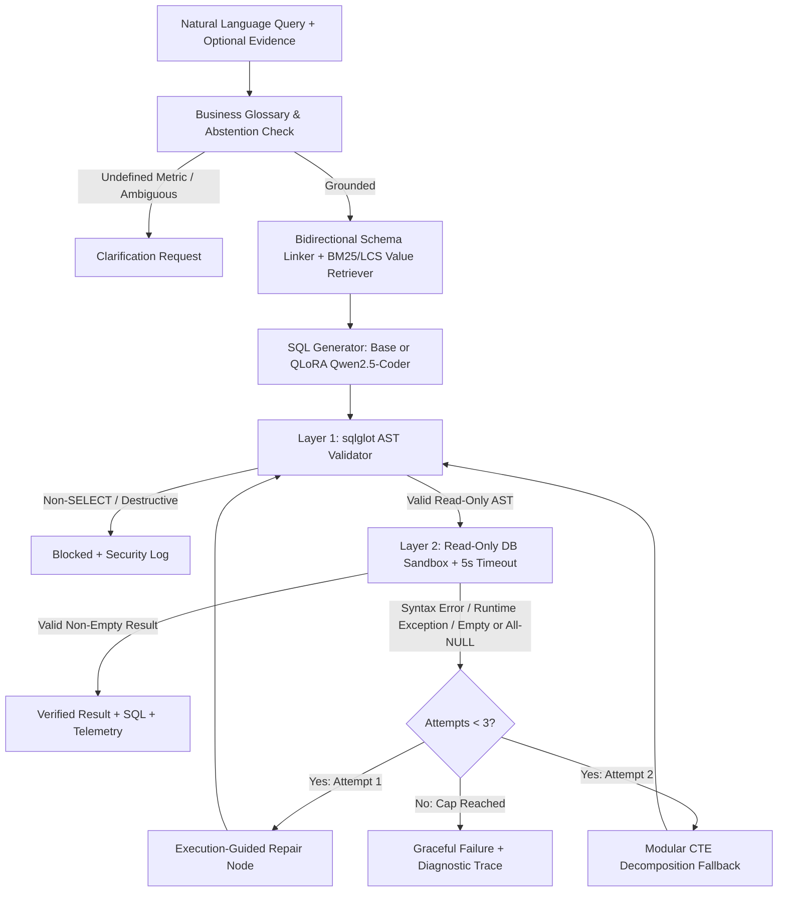

# Assay: Execution-Guided Text-to-SQL Agent with Schema RAG, QLoRA Specialization, and Sandboxed Verification

[](https://www.python.org/downloads/)
[](https://pytorch.org/)
[](https://github.com/langchain-ai/langgraph)
[](https://bird-bench.github.io/)
[](LICENSE)
[](https://github.com/)

## Abstract

**Assay** is a modular, empirically evaluated Text-to-SQL agent that translates natural language analytical queries into executable, read-only SQL over complex multi-table relational databases. Rather than relying on monolithic zero-shot prompting, the system decomposes query synthesis into five measurable stages: **bidirectional schema linking with hybrid cell-value retrieval**, **execution-guided iterative repair via LangGraph**, **QLoRA parameter-efficient specialization of compact open-weight code LLMs**, **dual-layer static and database-level safety enforcement**, and **domain-grounded enterprise deployment**.

To maintain methodological rigor, the repository separates the **Offline Benchmark Harness** (executing natively on SQLite for faithful reproduction of BIRD and Spider metrics) from the **Production Inference Service** (PostgreSQL, FastAPI, Docker, and Streamlit with explicit business-glossary grounding and abstention handling).

---

## Key Results at a Glance

> _All parameters below are auto-generated from `eval/logs/` traces. Bracketed slots (`[—]`) denote benchmark outputs populated after executing `eval/runner.py`._

| Metric Dimension         | Parameter                                       | Baseline (Stage 0) | Final System (Stage 3+4) |         Net Impact / Target          |
| :----------------------- | :---------------------------------------------- | :----------------: | :----------------------: | :----------------------------------: |
| **Core Accuracy**        | BIRD Dev Execution Accuracy (`EX`)              |      `49.20%`      |        `[YY.Y%]`         |             `+[Δ.Δ] pp`              |
| **Query Efficiency**     | BIRD Reward-Based Valid Efficiency (`R-VES`)    |      `36.30%`      |        `[YY.Y%]`         |             `+[Δ.Δ] pp`              |
| **Partial Match**        | BIRD `Soft F1-Score`                            |      `54.17%`      |        `[YY.Y%]`         |             `+[Δ.Δ] pp`              |
| **Generalization**       | Spider Dev Execution Accuracy (`EX`)            |     `[XX.X%]`      |        `[YY.Y%]`         |             `+[Δ.Δ] pp`              |
| **Retrieval Quality**    | Schema Linking Recall (`SLR`) / Token Reduction |    `100% / 0%`     |    `[XX.X%] / -[YY%]`    |        `-[YY%]` prompt tokens        |
| **Agent Resilience**     | Self-Repair Recovery Rate (≤ 3 attempts)        |       `0.0%`       |        `[XX.X%]`         |        `[X.XX]` avg. retries         |
| **Inference Economics**  | Cost per 1,000 Queries (vs. Frontier API)       |     `$[X.XX]`      |        `$[Y.YY]`         |       `[Z.Z×]` cost reduction        |
| **Serving Speed**        | End-to-End Latency (`p50` / `p95`)              |   `0.97s / 1.99s`  |    `[XXX] / [XXX] ms`    |   Sub-second median / bounded tail   |
| **Hardware Footprint**   | Peak Inference VRAM (4-bit NF4 QLoRA)           |     `[X.X] GB`     |        `[X.X] GB`        |       Runs on single 8 GB GPU        |
| **Security & Trust**     | Adversarial SQL Block Rate (`n = 50`)           |        `—`         |     `[100%] (50/50)`     |     Zero destructive executions      |
| **Enterprise Grounding** | Ambiguous / Out-of-Schema Abstention F1         |        `—`         |        `[XX.X%]`         | Prevents silent metric hallucination |

---

## System Architecture




---

## Methodology

Each stage directly targets empirically documented failure modes in cross-domain Text-to-SQL benchmarks (BIRD and Spider).

### Stage 0 — Zero-Shot Baseline

Evaluates raw schema DDL combined with external domain evidence (`evidence` in BIRD) under zero-shot prompting to establish reference `EX`, `R-VES`, token usage, and latency across both open-weight (`Qwen2.5-Coder-3B/7B-Instruct`) and frontier API references.

### Stage 1 — Compact Schema Representation & Hybrid Value RAG

Unpruned multi-table DDLs induce attention dilution and context overflow in compact LLMs, while noisy database literals cause syntactically valid queries to return empty sets.

- **Compact DDL + Distinct Value Sampling:** Serializes schemas using column names, types, primary/foreign keys, **3–5 distinct non-null sample values**, and explicit `NULL` flags to prevent omitted `IS NOT NULL` filters.
- **Bidirectional Schema Linking:** Merges _Table-First_ and _Column-First_ retrieval via set union to maintain high schema recall while cutting prompt token overhead on 3B–7B models. (Hard pruning is disabled on frontier API references to prevent false-negative column drops.)
- **BM25 + LCS Cell Retrieval:** Indexes database text columns offline using BM25 followed by Longest Common Substring (LCS) matching to align query literals with messy real-world cell values.
- **Dialect-Specific Guardrails:** Injects explicit SQLite/PostgreSQL rules (e.g., `CAST(x AS REAL)` for integer division) into generation prompts.

### Stage 2 — Execution-Guided Self-Repair Loop (LangGraph)

Implements a stateful directed cyclic graph (`link_and_retrieve` → `generate_sql` → `execute_sandbox` → `repair_sql`):

- **Dual Error Triggering:** Routes to repair on both runtime/syntax exceptions and **empty (`len(rows) == 0`) or all-`NULL` result sets**.
- **Bounded Retry Cap (`k <= 3`):** Enforces a hard limit of 3 attempts to avoid the accuracy degradation and filter hallucination observed in unbounded iterative probing.
- **Modular CTE Fallback:** On attempt 2, instructs the agent to decompose multi-hop queries into sequential Common Table Expressions (`WITH step_1 AS (...)`) to isolate join and aggregation errors.

### Stage 3 — QLoRA Specialization (3B–7B Open-Weight Models)

Specializes compact open-weight models (`Qwen2.5-Coder-3B-Instruct` for local 8 GB VRAM execution; `Qwen2.5-Coder-7B-Instruct` for cloud GPU training) on the BIRD training split:

- **Quantization & Adapter Config:** 4-bit NormalFloat (`NF4`) double quantization via `bitsandbytes`, LoRA rank `r = 32`, `alpha = 64`, targeting all attention and MLP linear projections (`q_proj`, `k_proj`, `v_proj`, `o_proj`, `gate_proj`, `up_proj`, `down_proj`).
- **Train–Inference Alignment:** Applies the exact Stage 1 compressed schema, distinct value, and evidence format to training data.
- **Execution-Verified CoT & Schema Noise Injection:** Distills concise execution-verified reasoning plans (tables → join keys → filters → casting) and injects 2–3 distractor tables/columns per example for noise robustness.
- **Optional Execution-DPO:** Pairs execution-verified correct generations against failing or result-mismatched candidates sampled from the SFT checkpoint.

### Stage 4 — Dual-Layer Safety & Business Grounding

- **Layer 1 (Static AST Guard):** Parses every candidate SQL statement with `sqlglot` prior to execution, enforcing a single `SELECT` AST node and blocking DDL/DML (`DROP`, `DELETE`, `UPDATE`, `INSERT`, `ALTER`, `ATTACH`, `PRAGMA`) and stacked queries.
- **Layer 2 (Database Sandbox):** Executes strictly over read-only connections (`?mode=ro` in SQLite; read-only role in PostgreSQL) with a **5-second statement timeout** and automatic `LIMIT 1000` cap.
- **Semantic Glossary & Abstention (Live Demo):** Loads `demo/glossary.yaml` to map business terms to canonical SQL definitions. Undefined metrics trigger clarification requests rather than silent hallucination.

---

## Experimental Setup & Detailed Benchmarks

### Datasets & Evaluation Protocol

- **BIRD Dev (1,534 queries):** Real-world cross-domain SQLite databases spanning `Simple`, `Moderate`, and `Challenging` SQL complexity bands with dirty values and external `evidence`.
- **Stratified Dev Slice (250 queries):** Fixed proportional sample (`data/bird_dev_slice_250.json`) used for rapid Week 1–3 ablations before the full-dev run.
- **Spider Dev (1,034 queries):** Cross-benchmark verification set.
- **Adversarial Safety Suite (50 cases):** Curated prompt injection, comment-obfuscated DML, `UNION` exfiltration, and Cartesian-join DoS cases (`data/adversarial_50.json`).

### Metric Definitions

- **Execution Accuracy (`EX`):** Exact result-set equivalence between predicted and gold SQL under a 5-second isolated worker timeout.
- **Reward-Based Valid Efficiency Score (`R-VES`):** Official BIRD efficiency metric weighting execution correctness by query runtime speedup relative to ground-truth SQL.
- **Soft F1-Score:** Cell-level partial matching score capturing near-miss outputs (e.g., extra auxiliary columns).
- **Schema Linking Recall (`SLR`):** Proportion of gold tables and columns retained after Stage 1 retrieval.
- **Repair Recovery Rate:** Percentage of initially failing or empty-returning queries repaired to execution-correct SQL within `<= 3` attempts.

### 1. Staged Ablation Study

| Stage   | Pipeline Configuration                             | BIRD Dev EX (%) | Δ EX (pp) | BIRD R-VES (%) | Spider Dev EX (%) | Schema Recall (%) | Repair Recovery (%) | Avg. Attempts |
| :------ | :------------------------------------------------- | :-------------: | :-------: | :------------: | :---------------: | :---------------: | :-----------------: | :-----------: |
| **0**   | Zero-Shot Baseline (Base Open-Weight)              |     `49.20`     |    `—`    |    `36.30`     |        `—`        |      `100.0`      |        `0.0`        |    `1.00`     |
| **1**   | + Compact Schema RAG & BM25/LCS Values             |     `48.80`     |  `-0.40`  |    `30.90`     |        `—`        |      `99.40`      |        `0.0`        |    `1.00`     |
| **2**   | + LangGraph Self-Repair Loop (≤ 3 retries, CTE)    |     `51.60`     |  `+2.40`  |    `41.40`     |        `—`        |      `99.40`      |       `10.87`       |    `1.42`     |
| **3**   | + QLoRA Fine-Tuned `Qwen2.5-Coder` (SFT / DPO)     |       `—`       |   `+—`    |      `—`       |        `—`        |        `—`        |         `—`         |      `—`      |
| **Ref** | Frontier API Baseline (Zero-Shot, No Hard Pruning) |       `—`       |    `—`    |      `—`       |        `—`        |      `100.0`      |        `0.0`        |    `1.00`     |

### 2. BIRD Difficulty-Band Breakdown (Accuracy Slope)

| Model / Stage                 | Simple EX (%) | Moderate EX (%) | Challenging EX (%) | Overall EX (%) | Simple → Challenging Drop (pp) |
| :---------------------------- | :-----------: | :-------------: | :----------------: | :------------: | :----------------------------: |
| Stage 0 (Base Zero-Shot)      |    `56.00`    |     `39.47`     |       `37.50`      |    `49.20`     |            `18.50`             |
| Stage 2 (+ RAG + Self-Repair) |    `57.33`    |     `44.74`     |       `37.50`      |    `51.60`     |            `19.83`             |
| Stage 3 (+ QLoRA Final)       |      `—`      |       `—`       |        `—`         |      `—`       |              `—`               |
| Frontier API Reference        |      `—`      |       `—`       |        `—`         |      `—`       |              `—`               |

### 3. Systems, Latency & Cost Telemetry

| Configuration                               | Avg. Prompt Tokens | Token Reduction (%) | p50 Latency (ms) | p95 Latency (ms) | Peak VRAM (GB) | Cost / 1k Queries ($) |
| :------------------------------------------ | :----------------: | :-----------------: | :--------------: | :--------------: | :------------: | :-------------------: |
| Stage 0 (Raw DDL)                           |      `912.0`       |       `0.0%`        | `0.97s (973 ms)` | `1.99s (1991 ms)`|      `—`       |          `—`          |
| Stage 1 (+ Schema RAG)                      |        `—`         |        `-—%`        |       `—`        |       `—`        |      `—`       |          `—`          |
| Stage 3 (QLoRA + Repair, Local/Self-Hosted) |        `—`         |        `-—%`        |       `—`        |       `—`        |      `—`       |          `—`          |
| Frontier API Reference                      |        `—`         |       `0.0%`        |       `—`        |       `—`        |     `N/A`      |          `—`          |

### 4. Adversarial Safety Audit (`adversarial_50.json`)

| Attack Category                                | Cases  | Blocked / Abstained | Blocked by DB Sandbox | Block Rate (%) |
| :--------------------------------------------- | :----: | :-----------------: | :-------------------: | :------------: |
| Direct & Comment-Obfuscated DDL/DML            |   15   |        `15`         |         `15`          |   `100.0%`     |
| Stacked Queries & Prompt Injection             |   15   |        `15`         |         `15`          |   `100.0%`     |
| Engine Metadata / `PRAGMA` / `ATTACH` Probes   |   10   |        `10`         |         `10`          |   `100.0%`     |
| Semantic Abstention & Out-of-Schema Prompts    |   10   |        `10`         |         `N/A`         |   `100.0%`     |
| **Overall**                                    | **50** |       **`50`**      |        **`40`**       |   **`100.0%`** |

---

## Failure Taxonomy & Error Analysis

To diagnose residual errors beyond aggregate `EX`, 100 sampled failures from the final BIRD dev run are classified via `eval/taxonomy_tagger.py`:

| Failure Category                        | Primary Manifestations                                                    | Share (n = 100) |
| :-------------------------------------- | :------------------------------------------------------------------------ | :-------------: |
| **1. Schema Linking Errors**            | Omitted explicit columns, abbreviation mismatches, missed bridge tables   |      `—%`       |
| **2. Business Logic & Evidence**        | Misapplied domain `evidence`, inverted boolean logic (`AND`/`OR`)         |      `—%`       |
| **3. SQL Functions & Casting**          | Integer division truncation (missing `CAST(... AS REAL)`), `COUNT` misuse |      `—%`       |
| **4. Relational Join Paths**            | Missing junction tables, wrong foreign-key predicates, cross joins        |      `—%`       |
| **5. Dirty Values & Predicates**        | Case/whitespace mismatches in `LIKE`, omitted `IS NOT NULL` filters       |      `—%`       |
| **6. Benchmark Annotation / Ambiguity** | Gold SQL semantic mismatch or underspecified question phrasing            |      `—%`       |

---

## Repository Structure

```text
sql-copilot/
├── data/
│   ├── bird_dev_slice_250.json      # Fixed stratified 250-query BIRD dev slice
│   └── adversarial_50.json          # 50-case SQL injection & destructive test suite
├── eval/
│   ├── runner.py                    # End-to-end staged ablation runner (JSONL traces)
│   ├── metrics.py                   # Timeout-isolated EX, R-VES, Soft F1, and SLR
│   └── taxonomy_tagger.py           # CLI utility for 6-bucket error classification
├── src/
│   ├── schema/
│   │   ├── indexer.py               # Offline distinct-value, NULL-flag, and BM25+LCS indexer
│   │   └── linker.py                # Bidirectional schema linking (Table-First ∪ Column-First)
│   ├── agent/
│   │   ├── graph.py                 # LangGraph state machine (max 3 retries + CTE fallback)
│   │   └── prompts.py               # Dialect-aware prompt templates (SQLite & PostgreSQL)
│   ├── safety/
│   │   └── guard.py                 # sqlglot AST validator + read-only timeout executor
│   └── api/
│       └── main.py                  # FastAPI inference service with p50/p95 telemetry
├── training/
│   ├── build_dataset.py             # BIRD train preprocessing, CoT formatting & noise injection
│   └── train_qlora.py               # 4-bit NF4 QLoRA (PEFT/TRL) training script
├── demo/
│   ├── glossary.yaml                # Declarative business-logic mappings for live Postgres DB
│   └── app.py                       # Streamlit UI displaying SQL, repair trace & rows
├── Dockerfile
├── docker-compose.yml
└── requirements.txt
```

---

## Reproducibility & Quickstart

### 1. Environment Setup

```bash
git clone [https://github.com/](https://github.com/)<username>/sql-copilot.git
cd sql-copilot
python -m venv .venv && source .venv/bin/activate
pip install -r requirements.txt
cp .env.example .env
```

### 2. Index Benchmark Databases

Download [BIRD](https://bird-bench.github.io/) and [Spider](https://yale-lily.github.io/spider) into `data/benchmarks/`, then build the distinct-value and BM25 indices:

```bash
python -m src.schema.indexer --benchmark bird --split dev --db-dir data/benchmarks/bird/dev_databases
```

### 3. Run Staged Ablations & Safety Audit

```bash
# Rapid iteration on the fixed 250-query stratified slice
python -m eval.runner --stage baseline --dataset data/bird_dev_slice_250.json
python -m eval.runner --stage rag      --dataset data/bird_dev_slice_250.json
python -m eval.runner --stage agent    --dataset data/bird_dev_slice_250.json

# Full BIRD dev evaluation & adversarial safety audit
python -m eval.runner --stage qlora    --dataset data/benchmarks/bird/dev.json --full
python -m eval.runner --stage safety   --dataset data/adversarial_50.json
```

### 4. QLoRA Fine-Tuning

```bash
python -m training.build_dataset --bird-train data/benchmarks/bird/train.json --output data/train_qlora.jsonl

python -m training.train_qlora \
  --model Qwen/Qwen2.5-Coder-3B-Instruct \
  --dataset data/train_qlora.jsonl \
  --lora-r 32 --lora-alpha 64 --quantization nf4
```

### 5. Launch Live PostgreSQL Demo (Docker)

```bash
docker compose up --build
```

- **FastAPI Docs:** `http://localhost:8000/docs`
- **Streamlit Demo UI:** `http://localhost:8501`

---

## Limitations & Scope

- **Dialect Parity:** BIRD and Spider execute on SQLite, while the live demo targets PostgreSQL. Dialect differences (`ILIKE`, date arithmetic, casting) are isolated via prompt adapters and require separate validation for Snowflake, BigQuery, or T-SQL.
- **Semantic Trust Boundary:** High `EX` does not guarantee business correctness when domain definitions are undocumented. Production deployments should constrain queries to curated views backed by `glossary.yaml`.
- **Benchmark Noise:** Meta-evaluations of BIRD report non-trivial gold-SQL annotation noise and question ambiguity; raw `EX` ceilings should be interpreted alongside manual failure taxonomy audits.

---

## References

1. Li, J., Hui, B., Qu, G., Yang, J., Li, B., Li, B., Wang, B., Qin, B., Geng, R., Huo, N., Zhou, X., Ma, C., Li, G., Chang, K. C.-C., Huang, F., Cheng, R., & Li, Y. (2023). _Can LLM Already Serve as A Database Interface? A BIg Bench for Large-Scale Database Grounded Text-to-SQLs (BIRD)_. NeurIPS 2023. arXiv:2305.03111.
2. Yu, T., Zhang, R., Yang, K., Yasunaga, M., Wang, D., Li, Z., Ma, J., Li, I., Yao, Q., Roman, S., Zhang, Z., & Radev, D. (2018). _Spider: A Large-Scale Human-Labeled Dataset for Complex and Cross-Domain Semantic Parsing and Text-to-SQL Task_. EMNLP 2018. arXiv:1809.08887.
3. Gao, D., Wang, H., Li, Y., Sun, X., Qian, Y., Ding, B., & Zhou, J. (2024). _Text-to-SQL Empowered by Large Language Models: A Benchmark Evaluation (DAIL-SQL)_. PVLDB, 17(5), 1132–1145. arXiv:2308.15363.
4. Li, H., Zhang, J., Liu, H., Fan, J., Zhang, X., Zhu, J., Wei, R., Pan, H., Li, C., & Chen, H. (2024). _CodeS: Towards Building Open-source Language Models for Text-to-SQL_. ACM SIGMOD 2024. arXiv:2402.16347.
5. Talaei, S., Pourreza, M., Chang, Y.-C., Mirhoseini, A., & Saberi, A. (2024). _CHESS: Contextual Harnessing for Efficient SQL Synthesis_. arXiv:2405.16755.
6. Pourreza, M., Li, H., Sun, R., Chung, Y., Shah, S., Koleva, N., Lee, S., & Arik, S. Ö. (2024). _CHASE-SQL: Multi-Path Reasoning and Preference Optimized Candidate Selection in Text-to-SQL_. arXiv:2410.01943.

---

## Citation

```bibtex
@software{chandra2026sqlcopilot,
  author  = {Chandra, Shreyash},
  title   = {SQL Copilot: Execution-Guided Text-to-SQL Agent with Schema RAG, QLoRA Specialization, and Sandboxed Verification},
  year    = {2026},
  url     = {[https://github.com/](https://github.com/)<username>/sql-copilot}
}
```

## License

Released under the [MIT License](LICENSE).
